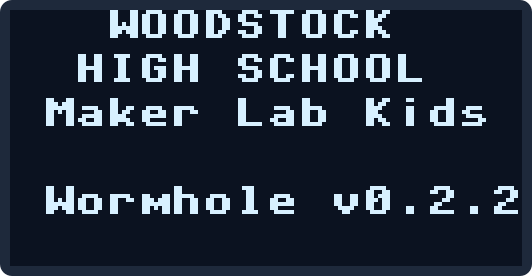
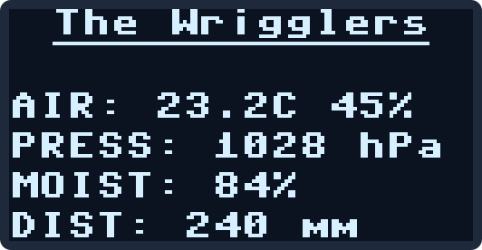
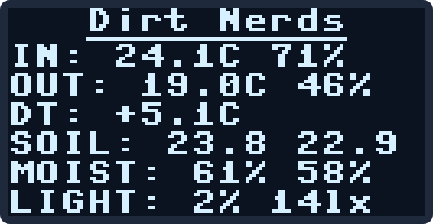
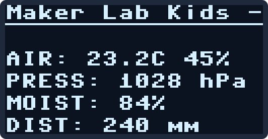
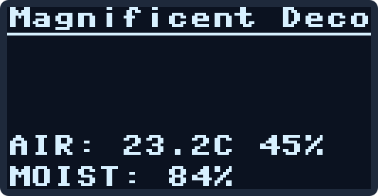

# Worm Bin Command Center

**[Open this project in Viper IDE](https://viper-ide.org/?install=github:MakerLabKids/whs-wormhole/projects/worm-bin/package.json)**: one click installs everything it needs onto a connected Pico.

The capstone: every sensor in the toolbox, and the actuators, running
off ONE Pico at the same time. Everything is optional, hot-pluggable,
and reported honestly by the truth light, the OLED, and a live web
dashboard with controls.

## The full wiring

All I2C devices share the standard bus (SDA=GP0, SCL=GP1, 3V3, GND).

| Part | Where | Notes |
| ---- | ----- | ----- |
| OLED | I2C `0x3C` | one screen of whatever is reporting; pages only if that overflows |
| BME280 "in" | I2C `0x76` | inside the bin (SDO to GND) |
| BME280 "out" | I2C `0x77` | outside the bin (SDO to 3V3) |
| ADS1115 | I2C `0x48` | ADDR to GND; adds 4 analog channels |
| Soil moisture 1 | ADS1115 A0 | capacitive v1.2, VCC 3V3 |
| Soil moisture 2 | ADS1115 A1 | second probe, other end of the bin |
| Soil moisture, direct | GP26 (pin 31, ADC0) | no ADS1115: probe AOUT straight into the Pico, set `MOIST_PIN = 26` |
| GL5528 light divider | ADS1115 A2 | LDR to 3V3, 10k to GND, junction to A2 |
| MAX9814 mic | GP27 (pin 32, ADC1) | native ADC: needs the fast 25 ms sampling |
| DS18B20 probes | GP22 (pin 29) | one wire, many probes, 4.7k pullup to 3V3 |
| VL53L0X compaction | I2C `0x29` | lid-mounted, aimed down: gap to the bedding surface (settling/compaction) |
| Big servo (MG995) | GP16 (pin 21) | own 5V supply, grounds joined, NOT VBUS |
| Small servo (SG90) | GP17 (pin 22) | power from VBUS (pin 40) |
| Relay module | GP15 (pin 20) | module VCC per its spec (most take VBUS 5V) |

Free for expansion: GP26 (ADC0), GP28 (ADC2), ADS1115 A3, and the whole
second I2C bus (I2C1).

## The truth light

POST codes: one blink per part, in the order of the `PARTS` list in
`main.py`, then one slot per DS18B20 probe (always last, so adding a
probe grows the tail of the pattern without renumbering anything).
Short blink = OK, long blink = trouble, dark = code not running.

Default slot order: 1 BME in, 2 BME out, 3 ADS1115 bank, 4 mic, 5 light,
6 compaction, 7 lux, then the probes. Comment a part out of `PARTS` and its
slot disappears; the pattern only ever shows what you claim to have wired.
The mic and the light divider sit on bare ADC pins and cannot tell
"unplugged" from "quiet", so for a bin without them set `MIC_PIN = None`
or `LIGHT_PIN = None` in the config block: that drops them from the slots,
the screen, and the dashboard.

## Pressure

Weather reports quote pressure corrected to sea level; a BME280 reads the
real pressure where it sits, a few percent lower at our altitude. Set
`ELEVATION_M` in the config block (Woodstock High School is about 305 m)
and `press_hpa` on the screen, the JSON and the dashboard matches the
weather app, while `press_raw_hpa` keeps the uncorrected reading. Set it
to 0 to show the raw reading everywhere.

## The screen

Power on: one of ten animated worm shows (a different one each boot;
`lib/wormshow.py`, gallery at docs/splash.html, `SPLASH_SHOW = False`
to skip it), the start-up card for three seconds, then one screen built
from whatever is reporting.

 

The team name (the board's Wi-Fi name) sits centered across the top,
underlined. The readings are `LABEL: value` rows, one per part that is
reporting and nothing for parts that are absent, stacked up from the
bottom edge, so whatever is left over is air under the name. A lean bin
(one BME280, a probe, a moisture bank, the distance sensor) fits on a
single screen and never pages. Six readings tighten the row spacing; only
when more rows exist than fit (six under the title) does it page, and then
only through rows that exist, lingering on a page with a light sensor so
you can shine a torch at it. Servo and relay get a row only once something
has been commanded.

 

The top row is also a marquee: the name holds for five seconds, then
`MARQUEE` (the school and program line, in the config block) scrolls
through, then the name holds again. A name too wide for the screen (more
than 16 characters) scrolls instead of holding and still gets its five
seconds. `MARQUEE = ""` turns the scroll off.

The pictures above are not photos: `micropython tools/gen-oled.py` runs
the real driver and layout code off-board and writes the screen buffer out
as SVG, so they are exactly the pixels the board draws.

A lean bin recipe, for a board with one BME280, a probe, a moisture sensor
on GP26, the distance sensor and the OLED: in the config block set
`MOIST_PIN = 26`, `MIC_PIN = None`, `LIGHT_PIN = None`, and comment
`bme("in", 0x76)`, `analog_bank()` and `lux_meter()` out of `PARTS`. The
result is a single screen and a truth light with four short blinks.

## The PIN

Nothing on a board changes over Wi-Fi without its PIN: the servo
sliders and the relay button, calibration, probe placements, and the
rename control. Reading never needs it (the page, `/data`, `/history`,
the screen). Plugging into USB is the other key: Viper, mpremote and
the file panel are not gated, because holding the board is holding the
key.

The PIN is worked out from what the board's own screen says, its name
and the address you browse to, so a teacher can always derive it and a
team that reads this paragraph can too (that is on purpose: a low wall
that rewards effort). Two numbers written one after the other:

1. the **second letter** of the name as a number (a=1 ... z=26) **plus
   the first digit** of the address's last number;
2. the **second-to-last letter** of the name as a number **plus the
   last digit** of the address's last number.

"The Wrigglers", bin 16, browsed at 192.168.4.16: h is 8, plus 1 =
**9**; r is 18, plus 6 = **24**; PIN **924**. Only letters count
(spaces, digits and punctuation are skipped).

The last number of the address is the bin number, on both networks: a
board hosts its own hotspot at 192.168.4.<bin>, and on the classroom
network it takes <room subnet>.<bin> as a fixed address instead of a
DHCP lease. So the number on the lid, the screen, the URL and the PIN
all agree, and the PIN is the same wherever you reach the board from.
Bins are numbered once across the whole fleet (the roster, `tools/fleet`,
from 30 up), never 1, 10, 16-23 or 100+, which belong to the router,
the Burrow, the hotspot's own phone leases and the DHCP pool. A board
with no team card stays at 192.168.4.1 and a DHCP lease.

Renaming a board (dashboard, "Board name", needs the current PIN)
restarts it under the new name, which is also its new Wi-Fi name and
its new PIN. Five wrong PINs in a row lock every change for a minute.

## Dashboard

Join the board's own network (its team name), browse to the address on
its screen (192.168.4.<bin>): live cards
for both airs, both moistures, light, sound, compaction, and every probe,
plus sliders for both servos and a relay button. JSON at `/data`,
actuator control at `/set?big=90`, `/set?small=45`, `/set?relay=1`.

## Calibration

**Distance (compaction).** `lib/vl53l0x.py` is a port of Pololu's
driver (ST's full init and reference calibration; the old one skipped
that and read 80 mm long). Each module still has its own offset from its
cover glass and mounting, so calibrate it for the range a bin actually uses: the empty bin (easy to check before
the bedding goes in) and the 30-50 mm gap a working bin sits at. On the
dashboard's Surface calibration card: with the bin empty, type the
measured depth and capture; then rest a box or book on the bottom so the
lid-to-target gap is a measured 40 mm or so, type that, capture, Apply.
One point sets the offset, two set a line; the correction lives in
`cal.json` on the board and applies to everything (screen, JSON, Burrow).
Readings are smoothed: `surface_now_mm` (a second or two, biased to the
latest shot) is on the screen and the local page; `surface_mm` (the mean
of the last minute) is what the Burrow records; `surface_raw_mm` is the
uncalibrated short average that the calibration card captures.

**Moisture.** `MOIST_DRY_V` / `MOIST_WET_V` at the top of `main.py` are in VOLTS
(the ADS1115 reads volts, not Pico counts). Watch `moist1_v` on the
dashboard with the probe dry in air, then in a cup of water up to the
marked line, and edit the two numbers.

## Power rules

- The MG995 gets its OWN 5V supply, grounds joined to the Pico. VBUS
  cannot feed a stalled MG995.
- The SG90 drinks from VBUS (pin 40), never 3V3.
- Everything else runs on 3V3.

Files needed on the board: `main.py`, `index.html`, and from `lib/`:
`picolab.py`, `ssd1306.py`, `bme280.py`, `ads1115.py`, `vl53l0x.py`.
Or use the one-click install link in the repo README.

---

Fresh board? Flash the [tested MicroPython build](https://github.com/MakerLabKids/whs-wormhole/raw/main/firmware/RPI_PICO2_W-20260406-v1.28.0.uf2) first: hold BOOTSEL while plugging in, drop the file on the drive that appears, done. Details in [firmware/](../../firmware).
